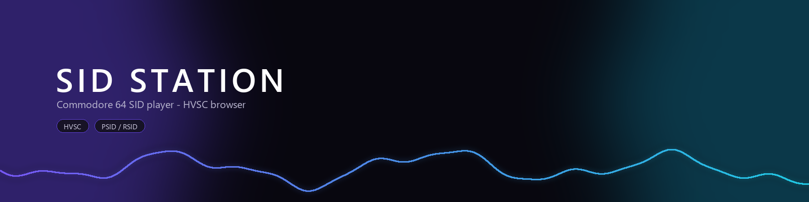
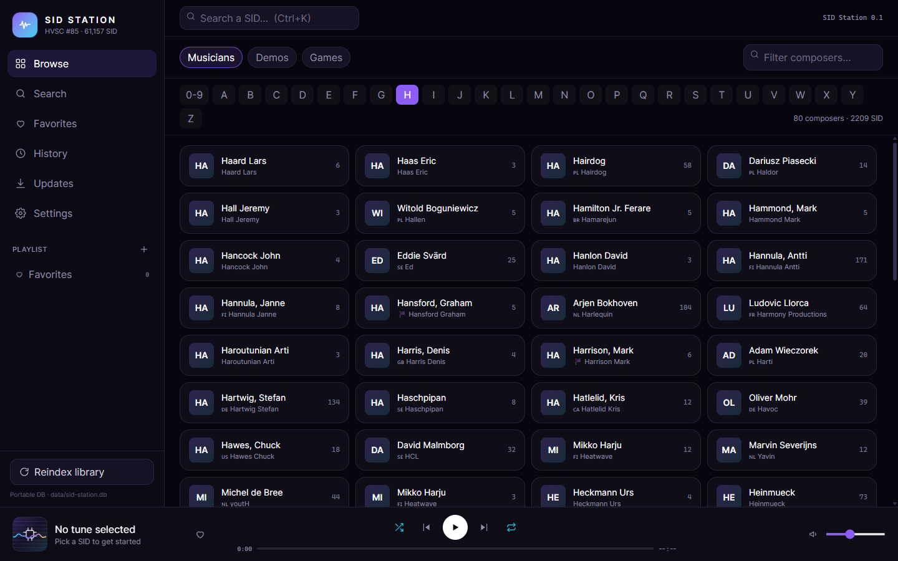
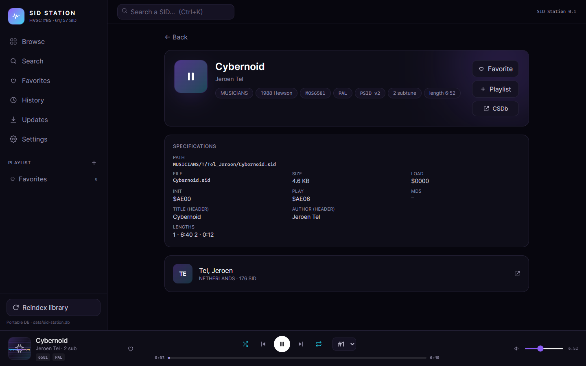
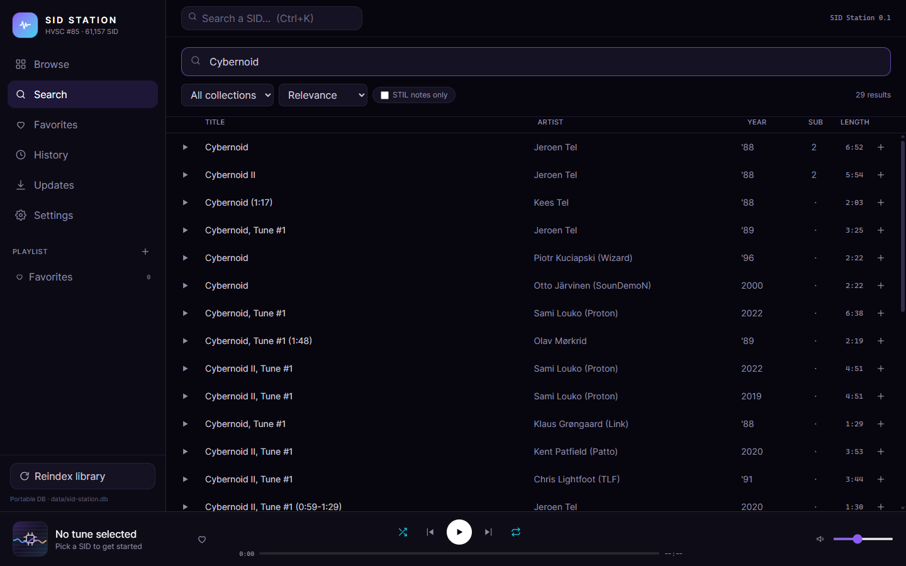
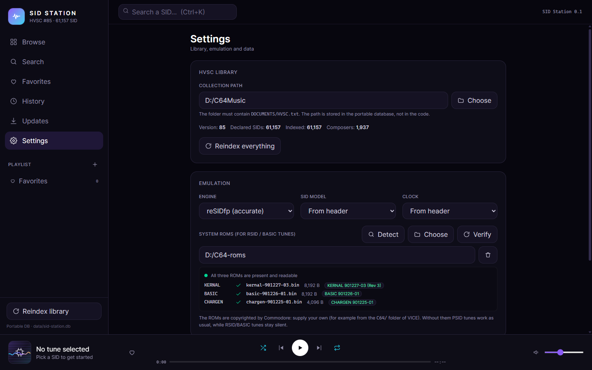

# SID Station

**A native Windows player and browser for the High Voltage SID Collection.**
Full-text search, composer pages, playlists, STIL notes and accurate Commodore 64
SID playback — all from a local HVSC folder, with no servers and no uploads.

[](LICENSE)




## Why another SID player

Most SID players are built around a playlist. HVSC is not a playlist: it is
61,000 tunes with composer folders, STIL comments, Songlengths and BUGlist
entries. SID Station indexes the collection into a local SQLite database and
lets you move through it the way you actually listen: find a composer, read the
notes, jump to a subtune, keep favourites, and let the tune play while you keep
browsing.

* Local-first: your HVSC folder is read in place, nothing is uploaded.
* Native: Tauri 2 shell (~5 MB installer) with the real libsidplayfp engine
  compiled to WebAssembly.
* Portable: the database lives next to the executable (`data/sid-station.db`)
  and can follow you on a USB stick.

## Features

- **Fast indexing** — a full HVSC #85 pass (61,157 SID) builds the database in a
  few seconds; reindexing is incremental-safe and keeps playlists and history.
- **Full-text search** — SQLite FTS5 (trigram) over title, artist and STIL text,
  with filters for collection, STIL-only, and relevance/title/artist/year/length
  ordering. Works with punctuation and hyphens.
- **Composer discovery** — browsable A–Z by collection, composer cards with real
  name, handle, country and tune counts, plus per-composer pages.
- **Tune pages** — header fields, load/init/play addresses, subtune list with
  per-subtune Songlengths, STIL notes, BUGlist warning, CSDb search link.
- **Playback** — PSID and RSID, subtune switching, seek bar, repeat/shuffle modes,
  keyboard shortcuts, and a live oscilloscope fed by an `AnalyserNode`.
- **Library management** — favourites, named playlists, listening history.
- **In-app HVSC updates** — checks the official hvsc.c64.org API, downloads from
  the official mirror, backs up the collection (~375 MB), runs the official HVS
  update tool, verifies the result and rolls back on failure.
- **C64 ROM support** — RSID and BASIC-driven tunes work when you point the app
  at KERNAL/BASIC/CHARGEN images, with per-ROM diagnostics and bounded
  auto-detection of VICE / C64 Forever installs.

## Screenshots

| Tune page | Search |
|---|---|
|  |  |

| Composer browser | Settings and C64 ROMs |
|---|---|
|  |  |

## Supported SID formats

| Format | Support | Notes |
|---|---|---|
| PSID v2 / v3 / v4 | ✅ | 57,233 files in HVSC #85 |
| RSID v2 | ✅ | 3,924 files; BASIC-driven tunes need C64 ROMs |
| Multiple subtunes | ✅ | 4,796 multi-subtune files in HVSC #85 |
| Songlengths.md5 | ✅ | per-subtune durations, used for the progress bar |
| STIL / BUGlist | ✅ | shown on the tune page |
| Raw `.sid` without header | ❌ | not part of HVSC |

## Audio engine

Playback runs inside the WebView through
[libsidplayfp-wasm](https://github.com/chrisgleissner/libsidplayfp-wasm), a
WebAssembly build of [libsidplayfp](https://github.com/libsidplayfp/libsidplayfp)
3.1.1 and [libresidfp](https://github.com/libsidplayfp/libresidfp) 1.2.3.
Audio is rendered at 48 kHz stereo and handed to an `AudioWorklet` ring buffer,
so the UI stays responsive while the engine renders ahead.

- **Engines:** reSIDfp (accurate) or SIDLite (faster, lower CPU).
- **Models:** MOS 6581 / MOS 8580, or "from header".
- **Clock:** PAL / NTSC, or "from header".
- SID model and clock changes are applied immediately (the engine reloads the
  current tune from its start).
- Emulation is used for playback only; SID Station does not emulate the C64
  beyond what the tunes need.

## HVSC integration

SID Station expects a normal HVSC checkout: point it at the folder that contains
`DOCUMENTS/HVSC.txt`. The collection is read in place; paths are stored
relative to the collection root, so moving the folder or changing drive letter
does not break playlists or history.

HVSC content is **not** bundled and is **not** downloaded automatically. Get the
collection from [hvsc.c64.org](https://hvsc.c64.org/) and respect its licence.

## Installation

Download the latest installer from
[Releases](https://github.com/BalTac/sid-station/releases):

- `SID Station_x.y.z_x64-setup.exe` — NSIS installer (per-user, no admin rights)
- `SID Station_x.y.z_x64_en-US.msi` — MSI package

Windows 10/11 x64 with the WebView2 runtime (preinstalled on Windows 11 and on
updated Windows 10). The installers are not code-signed, so SmartScreen may ask
for confirmation the first time.

### First run

1. Choose your HVSC folder when asked (or open **Settings → Collection path**).
2. Wait for the index pass: 61k tunes take a few seconds.
3. Browse, search, play. The database is created at `data/sid-station.db` next to
   the executable, or under `%LOCALAPPDATA%\SID Station` if that folder is not
   writable.

## C64 ROMs (RSID / BASIC tunes)

PSID tunes play without any system ROMs. RSID tunes that run as real C64
programs — including HVSC's `*_BASIC.sid` files — need the KERNAL, BASIC and
CHARGEN images, or they will run silently.

| ROM | Size | Typical file |
|---|---|---|
| KERNAL | 8,192 bytes | `kernal-901227-03.bin` |
| BASIC | 8,192 bytes | `basic-901226-01.bin` |
| CHARGEN | 4,096 bytes | `chargen-901225-01.bin` |

In **Settings → System ROMs** you can pick the folder manually or press
**Detect**, which only looks in the usual VICE and C64 Forever locations
(Program Files entries and uninstall records) instead of scanning the disk. The
panel shows one row per ROM with file name, size, SHA-256 and recognised
revision, plus duplicates and rejected files.

The ROMs are © Commodore/Cloanto: SID Station does not ship them and never
downloads them. Use images you are entitled to (for example from your own C64 or
from a VICE installation). The SHA-256 digests in `src-tauri/src/roms.rs` only
label known revisions; an unknown image of the right size is still accepted.

## Build from source

Requirements:

- Windows 10/11 x64
- [Node.js](https://nodejs.org/) 20 or newer
- [Rust](https://rustup.rs/) stable (MSVC toolchain)
- Visual Studio 2022 Build Tools with "Desktop development with C++"
- WebView2 runtime

```powershell
git clone https://github.com/BalTac/sid-station.git
cd sid-station
npm install            # also copies the WASM engines into public/wasm
npm run tauri dev      # development window with hot reload
npm run tauri build    # NSIS + MSI installers in src-tauri/target/release/bundle
```

The 7-Zip binaries used by the updater are checked in under
`src-tauri/resources/7z/` (LGPL, see [THIRD-PARTY-NOTICES.md](THIRD-PARTY-NOTICES.md)).
The SID engine `.wasm` files are copied from `node_modules` by
`scripts/copy-wasm.mjs`, so a fresh clone never depends on committed binaries.

## Development and testing

```powershell
npm run typecheck                                   # TypeScript
cargo test --manifest-path src-tauri/Cargo.toml     # Rust (HVSC tests skip)
$env:HVSC_ROOT = "D:\C64Music"                      # optional: run the HVSC tests
cargo test --manifest-path src-tauri/Cargo.toml -- --nocapture
```

The Rust suite covers SID/STIL/Songlengths/Musicians parsing, ROM scanning and
selection, and a full ingest of a real collection (`HVSC_ROOT`). Without
`HVSC_ROOT`, collection-dependent tests are skipped so CI stays green.

A quick engine check outside the app:

```powershell
node scripts/engine-check.mjs "D:\C64Music\MUSICIANS\H\Hubbard_Rob\Commando.sid" 3
```

## Project layout

```
src/                  React 19 + Tailwind UI (pages, components, state)
src/lib/audio.ts      libsidplayfp-wasm + AudioWorklet playback controller
src-tauri/src/        Rust backend: ingest, SQLite/FTS5, updater, ROM scan
src-tauri/tests/      parser, ingest, detection and ROM tests
public/               worklet and copied WASM engines (generated)
docs/screenshots/     screenshots used in this README
```

## Licence and third-party notices

SID Station is free software under the **GNU General Public License v2.0 or
later** ([LICENSE](LICENSE)); the "or later" is required because some
dependencies are Apache-2.0.

Third-party components, their licences and the bundled 7-Zip licence are listed
in [THIRD-PARTY-NOTICES.md](THIRD-PARTY-NOTICES.md).

**Content is separate from the software.** SID tunes, HVSC documents
(STIL, Songlengths, Musicians.txt) and Commodore ROM images remain the property
of their authors and are not covered by this repository's licence. None of them
are distributed here.

HVSC itself is not included: SID Station reads a collection you already have.
The HVSC name is used descriptively (what the app browses); the project is not
affiliated with or endorsed by the HVSC team. The collection's own
`DOCUMENTS/Disclaimer.txt` governs the tunes: they are copyrighted, private
enjoyment is the intended use, other uses need permission, and the HVSC crew
cannot grant licences. See [THIRD-PARTY-NOTICES.md](THIRD-PARTY-NOTICES.md) for
the quoted terms.

## Credits

- **HVSC** — the High Voltage SID Collection team (Ian Coog, 448, Wilfred Bos,
  Professor Chaos, Chris Abbott and the other members and contributors) and
  every composer who contributed tunes, STIL notes and Songlengths. HVSC is the
  reason this application exists; it is not affiliated with it.
- **libsidplayfp / libresidfp** — the emulation core, by the libsidplayfp
  maintainers and the reSID/reSIDfp authors.
- **libsidplayfp-wasm** — Chris Gleissner's WebAssembly build that makes
  in-WebView playback possible.
- **Tauri**, **React**, **Zustand**, **SQLite** — the application stack.
- **7-Zip** — bundled extractor for HVSC update packages.
- **VICE** — its published ROM images are the reference for the SHA-256 labels
  used by the ROM diagnostics.
- **CSDb** — linked from tune pages for release and composer information.

SID Station is an independent project, not affiliated with Commodore, Cloanto,
the HVSC team or the libsidplayfp maintainers.

## Contributing

Bug reports and pull requests are welcome — see [CONTRIBUTING.md](CONTRIBUTING.md)
and the [Code of Conduct](CODE_OF_CONDUCT.md). Security issues: see
[SECURITY.md](SECURITY.md).
